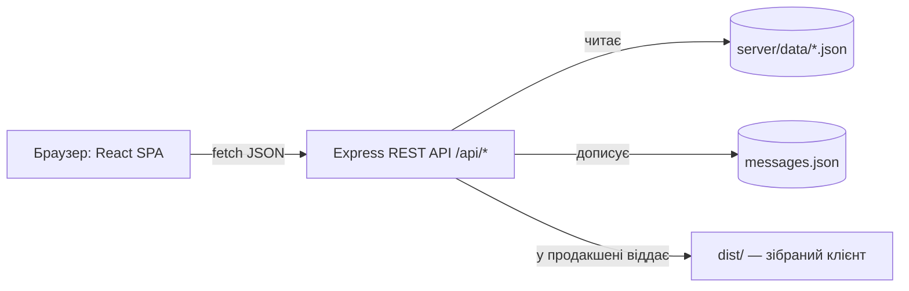

# Інформаційний портал «Перлини України» — специфікація

Дата: 2026-10-24. Дисципліна: «Веб-програмування», контрольна робота (РГР).

## 1. Вихідні вимоги

Тема: «Розробка інформаційного порталу «об'єкт дослідження» на основі web-технологій».

Обов'язковий склад порталу: головна сторінка, шапка з логотипом, меню, слайдер, вивід 10 головних новин, футер.
Меню: «Про сайт», «Галерея картинок», «Новини», «Контакти» (з картою Google). Дизайн адаптивний (мобільна і десктопна версії).

Загальні вимоги: повноцінний web-додаток з FrontEnd, взаємодія з BackEnd через REST API, демонстрація на безкоштовному хостингу, код у власному git-репозиторії.

**Ступінь складності 2:** HTML, CSS, JavaScript, jQuery, jQuery UI, Bootstrap, Flexbox, Grid, медіазапити + бібліотека React.js / Angular / Vue.js. Node.js і БД для 2 ступеня не обов'язкові.

## 2. Обраний об'єкт дослідження

Варіант №20 — **«Найвідоміші туристичні місця України»**. Назва порталу — **«Перлини України»**.

- Аудиторія: україномовні мандрівники, студенти, родини, що планують поїздки Україною.
- Основна задача порталу: показати найвідоміші місця країни (фото, короткі факти), публікувати новини порталу (путівники, маршрути, поради) і приймати звернення відвідувачів.
- Чому цей варіант: багатий візуальний матеріал з вільними ліцензіями (Wikimedia Commons), фактичний контент без вигаданих подій, природна потреба у галереї, слайдері та карті.

Правило контенту: «новини» — це публікації порталу (путівники, огляди, поради) з датою публікації на порталі. Реальних подій (відкриттів, фестивалів) не вигадуємо. Факти — лише загальновідомі й перевірювані (рік внесення до списку ЮНЕСКО, висота Говерли тощо).

## 3. Розглянуті підходи

| Підхід | Плюси | Мінуси |
|---|---|---|
| **A. React SPA (Vite) + власний REST API на Express з JSON-сховищем** (обрано) | Повний контроль над API (пагінація, фільтри, пошук, валідація), один сервіс для деплою, демонструє клієнт-серверну взаємодію | Потрібно написати сервер (≈150 рядків) |
| B. React SPA + json-server (мок-API) | Нуль серверного коду | Немає серверної валідації форми, обмежений формат відповідей |
| C. Багатосторінковий сайт на jQuery + Bootstrap + публічне API | Простіше | Не відповідає 2 ступеню (немає React), залежність від чужого API |

Рішення: підхід A. Node.js/Express використовується лише як легкий REST-бекенд; БД не використовується (для 2 ступеня не обов'язкова) — дані зберігаються у JSON-файлах.

## 4. Відповідність вимогам

| Вимога | Реалізація |
|---|---|
| Шапка з логотипом, меню | `Header` (react-bootstrap `Navbar`, бургер на мобільних), SVG-логотип `Logo` |
| Слайдер | `HeroSlider` на Bootstrap Carousel, слайди з `GET /api/slides` |
| 10 головних новин | `NewsGrid` на головній, `GET /api/news?limit=10` |
| Футер | `Footer` (CSS Grid, 3 колонки → 1 на мобільних) |
| Про сайт | сторінка `/about`, FAQ на **jQuery UI Accordion**, список авторів фото |
| Галерея картинок | `/gallery`: CSS Grid, фільтр за категорією, лайтбокс (Bootstrap Modal) |
| Новини | `/news`: пошук з **jQuery UI Autocomplete**, фільтр, пагінація; `/news/:id` — повний текст |
| Контакти + карта Google | `/contacts`: iframe Google Maps, форма з **jQuery UI Datepicker**, `POST /api/messages` |
| Адаптивність | Bootstrap-сітка, власні медіазапити (міксини SCSS), Flexbox, Grid |
| jQuery | кнопка «Нагору» (`animate`, `fadeIn/fadeOut`), ініціалізація віджетів jQuery UI |
| CSS-препроцесор | SCSS: змінні, міксини, вкладеність, модулі `@use`, кастомізація Bootstrap |
| REST API | Express 5: `GET /api/news`, `/api/news/:id`, `/api/gallery`, `/api/slides`, `/api/categories`, `POST /api/messages` |
| Хостинг і git | `render.yaml` для Render (безкоштовний план), git-репозиторій з історією комітів |

## 5. Архітектура



Структура репозиторію:

```
index.html, vite.config.js, package.json, render.yaml, README.md
public/            favicon.svg, images/places/{large,thumbs}/*.jpg
src/               клієнт (React)
  main.jsx, App.jsx
  api/client.js    — єдина точка звернення до REST API
  hooks/useApi.js  — завантаження даних (loading / error / data, скасування запиту)
  lib/jquery.js, lib/jqueryUi.js — підключення jQuery як глобального об'єкта і віджетів jQuery UI
  components/<Name>/<Name>.jsx + <Name>.scss
  pages/<Name>Page.jsx + .scss
  styles/          _tokens.scss, _mixins.scss, bootstrap.scss, global.scss, jquery-ui.scss
server/            бекенд (Node.js + Express)
  index.js         — запуск
  app.js           — createApp({ dataDir, messagesFile, distDir })
  lib/jsonStore.js — читання/дописування JSON
  routes/*.js      — news, gallery, slides, categories, messages
  data/*.json      — categories, slides, gallery, news
shared/validation.js — валідація форми (спільна для клієнта і сервера)
tests/             — node:test (API та валідація)
```

### 5.1 Контракт REST API

Усі відповіді — JSON. Помилки: `{ "error": "<текст українською>" }`, для форми додатково `fields`.

- `GET /api/health` → `200 { "status": "ok" }`
- `GET /api/categories` → `200 [{ "id": "castles", "name": "Замки та фортеці" }, …]`
- `GET /api/slides` → `200 [{ "id", "title", "subtitle", "text", "image", "newsId" }]`
- `GET /api/news?page=1&limit=10&category=castles&q=фортеця`
  - `page` — ціле ≥ 1 (за замовчуванням 1); `limit` — ціле 1…50 (за замовчуванням 10); інакше `400`.
  - `category` — id з `categories.json`, інакше `400`.
  - `q` — до 100 символів, пошук без урахування регістру в `title` і `excerpt`.
  - Сортування: `date` за спаданням, далі `id` за спаданням.
  - `200 { "items": [NewsSummary], "total", "page", "limit", "pages" }`; сторінка за межами → `items: []`.
  - `NewsSummary` = новина без поля `content`.
- `GET /api/news/:id` → `200 News` або `404 { "error": "Новину не знайдено" }`
- `GET /api/gallery?category=nature` → `200 [GalleryItem]`; невідома категорія → `400`
- `POST /api/messages` (тіло ≤ 10 КБ) → `201 { "id", "createdAt" }`; помилки валідації → `400 { "error", "fields": { "<поле>": "<повідомлення>" } }`; некоректний JSON → `400`
- Невідомий `/api/*` → `404 { "error": "Ресурс не знайдено" }`; збій сервера → `500 { "error": "Внутрішня помилка сервера" }`
- Поза `/api` у продакшені: статичні файли з `dist/`, для решти GET-запитів — `dist/index.html` (маршрутизація SPA).

### 5.2 Моделі даних

```jsonc
// categories.json
{ "id": "castles" | "nature" | "cities" | "sacred", "name": "Замки та фортеці" | "Природа" | "Міста" | "Святині" }
// slides.json
{ "id": 1, "title": "Кам'янець-Подільська фортеця", "subtitle": "Хмельницька область", "text": "1–2 речення", "image": "/images/places/large/kamianets.jpg", "newsId": 3 }
// gallery.json
{ "id": 1, "title": "…", "region": "… область", "category": "castles", "image": "/images/places/large/<slug>.jpg", "thumb": "/images/places/thumbs/<slug>.jpg", "width": 1600, "height": 1067, "author": "…", "license": "CC BY-SA 4.0", "licenseUrl": "https://…", "sourceUrl": "https://commons.wikimedia.org/wiki/File:…" }
// news.json
{ "id": 1, "title": "…", "date": "2026-10-20", "category": "nature", "region": "… область", "image": "/images/places/large/<slug>.jpg", "thumb": "/images/places/thumbs/<slug>.jpg", "excerpt": "1–2 речення", "content": ["абзац", "абзац", "абзац"] }
// messages.json (створює сервер)
{ "id": "uuid", "name", "email", "topic", "tripDate": "2026-11-15" | null, "message", "createdAt": "ISO" }
```

### 5.3 Валідація форми (`shared/validation.js`)

`validateMessage(input, { today })` → `{ valid, errors, data }`:

- `name` — обов'язкове, 2–80 символів після `trim`;
- `email` — обов'язкове, формат `user@domain.tld`;
- `topic` — один з `route` («Допомога з маршрутом»), `place` («Запропонувати місце»), `cooperation` («Співпраця»), `other` («Інше»);
- `tripDate` — необов'язкове; формат `YYYY-MM-DD`, реальна дата, не раніше `today`;
- `message` — обов'язкове, 10–2000 символів.

Той самий модуль використовують форма (миттєві підказки) і сервер (остаточна перевірка).

## 6. Клієнт

- Маршрути (React Router 7): `/`, `/about`, `/gallery`, `/news`, `/news/:id`, `/contacts`, `*` (404).
- `Layout` = `Header` + `<main>` + `Footer` + `ScrollTopButton`.
- Дані завантажуються через `useApi` (стан завантаження — спінер Bootstrap, помилка — `Alert` з кнопкою «Спробувати ще раз»).
- Стан фільтрів сторінки новин зберігається в URL (`?page=&category=&q=`) — посилання можна копіювати.
- Інтеграція jQuery UI з React: віджет створюється в `useEffect` на DOM-вузлі з `ref`, знищується (`destroy`) у функції очищення; React не перемальовує вузли, якими керує віджет.
- Bootstrap: кастомізація змінних у SCSS, компоненти react-bootstrap (`Navbar`, `Carousel`, `Modal`, `Pagination`, `Form`, `Alert`, `Spinner`), сітка `container/row/col`.

## 7. Дизайн-система

Принцип: фотографії — головні, інтерфейс стриманий; єдиний сміливий елемент — **орнаментальна смуга-вишивка** (геометричний хрестик-мотив), яка відкриває шапку, футер і підкреслює заголовки сторінок.

Кольори:

| Токен | Hex | Роль |
|---|---|---|
| `ink` (нічний індиго) | `#1D2B53` | текст, шапка, фон футера |
| `cherry` (вишиванковий червоний) | `#B01E2F` | орнамент, активний пункт меню, головна кнопка |
| `spruce` (смерека) | `#2E6B4F` | категорія «Природа» |
| `river` (дніпровська синь) | `#2F5DA8` | категорія «Міста», посилання |
| `ochre` (пшениця) | `#8A6100` | категорія «Святині» (контраст 5.5:1 на білому) |
| `mist` (карпатський туман) | `#EEF1F4` | фон чергових секцій |

Кольори категорій: замки — `cherry`, природа — `spruce`, міста — `river`, святині — `ochre`. Маркер категорії — маленький «хрестик» кольору категорії (несе інформацію, а не декорацію).

Шрифти (локально через Fontsource, без запитів до Google Fonts): **Unbounded** — заголовки, меню, кнопки; **Literata** — основний текст (18 px, міжрядковий інтервал 1.65, рядок ≤ 70 символів). Масштаб 1.25.

Макет головної:

```
[▒▒▒▒ орнамент ▒▒▒▒▒▒▒▒▒▒▒▒▒▒▒▒▒▒▒▒▒▒▒▒▒▒▒▒▒▒▒▒▒▒▒▒▒▒▒▒]
[◎ Перлини України        Головна Про сайт Галерея Новини Контакти]
[██████████████ слайдер на всю ширину, 70vh ██████████████]
[  Назва місця / область / «Читати»          ◆ ◇ ◇ ◇ ◇    ]
[ вступний абзац (≤ 60 символів у рядку)                   ]
[ 10 головних новин:  [ головна 2×2 ][  ][  ]              ]
[                     [            ][  ][  ]  … ще 6       ]
[▒▒▒▒ орнамент ▒▒▒▒]
[ футер: логотип + опис | навігація | контакти             ]
```

Відмовляємось від шаблонних прийомів: без однакових карток з тінями (новини — фото + текст без рамок), без заголовків капсом, без «→» у кнопках, без розділювачів «·». Мінімальна якість: адаптивність від 360 px, видимий фокус клавіатури, `prefers-reduced-motion` вимикає автопрокрутку слайдера та плавний скрол, alt-тексти для всіх фото, контраст тексту ≥ 4.5:1.

## 8. Контент і медіа

- 16 місць × 4 категорії; фото з Wikimedia Commons лише під CC0 / Public Domain / CC BY / CC BY-SA, з автором, ліцензією і посиланням на джерело (відображаються в лайтбоксі та на сторінці «Про сайт»).
- Розміри: `large` — ширина 1600 px, `thumbs` — 800 px, JPEG.
- 14 новин-публікацій (дати 2026-09-01…2026-10-20), 5 слайдів, FAQ з 5–6 питань.
- Контакти: «м. Київ, Майдан Незалежності» (публічна площа, не чужа установа), карта Google за координатами 50.4501, 30.5234.

## 9. Тестування

- `node --test`: валідація (`tests/validation.test.js`) і API (`tests/api.test.js`, сервер на випадковому порту з тестовими даними у тимчасовій теці).
- Перевірка в браузері: усі сторінки на ширині 1440 px і 390 px, робота слайдера, фільтрів, пагінації, автодоповнення, лайтбокса, відправка форми (успіх і помилки).

## 10. Деплой

Один вебсервіс Render (безкоштовний план): `npm ci --include=dev && npm run build`, старт `npm start`, перевірка здоров'я `/api/health`. Обмеження: «засинання» сервісу після простою, файлова система тимчасова (повідомлення з форми зберігаються до перезапуску). Код — у GitHub-репозиторії користувача.

## 11. Поза обсягом

Авторизація, адмін-панель, база даних, багатомовність, редагування новин через інтерфейс.

## 12. Пояснювальна записка

Формат як у прикладі: А4, поля 30/15/20/20 мм, Times New Roman 14, інтервал 1.5, абзац 1.25 см. Структура: титульний аркуш, вступ, розділ 1 (аналіз предметної області), розділ 2 (проєктування архітектури, вибір технологій), розділ 3 (практична реалізація зі скриншотами + керівництво користувача), висновки, список джерел. Скриншоти сторінок (десктоп і мобільна версія), коду та структури проєкту.
